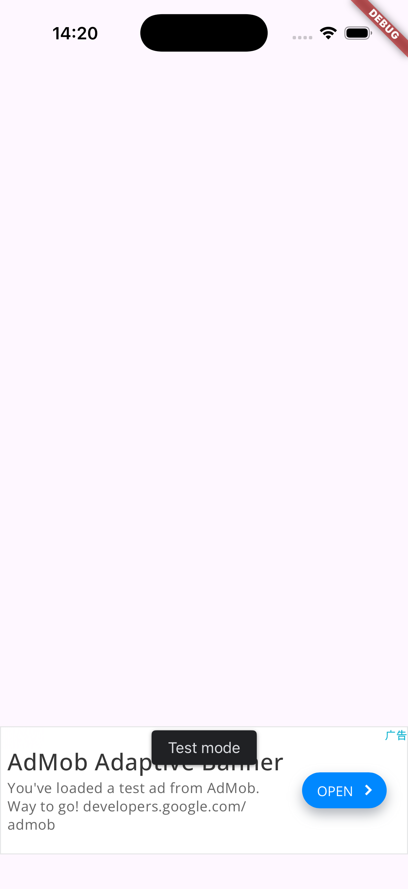
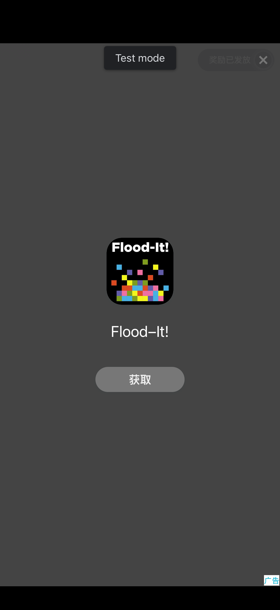
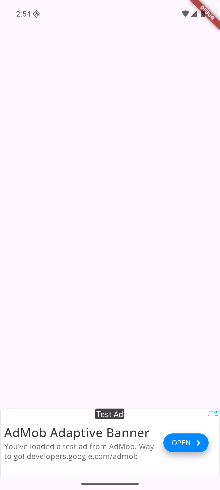

# AI Ad Monetization

[English](README.md) · [中文](README.zh-CN.md)

Your agent built the app. Now make it pay.

Coding agents are good at building the product. They are careless with ads. They pick the wrong network, skip consent, ship Google’s test IDs, and treat a green build as proof that an ad will show. Point your agent at this repository. It chooses the network, writes AdMob into the Flutter app, and will not mark a check as passed when that check never ran.

[](LICENSE)
[](package.json)
[](knowledge/platforms/admob/sdk/flutter.json)

The guides in `docs/` are written in Chinese. This file is the English entry point. The product page, in English and Chinese, is at [kelivora.github.io/ai-ad-monetization](https://kelivora.github.io/ai-ad-monetization/).

## What's in the box

Three pieces, used together or apart:

| Piece | Where | Role |
| --- | --- | --- |
| MCP server | `packages/mcp-server` | 14 tools. Twelve only read. One runs build and test commands. One writes the project, and only after a confirmed plan. |
| Skills | `skills/` | Eight workflows. They say which tool to call, what to decide, and what to do when a step fails. |
| Knowledge base | `knowledge/` | AdMob, AppLovin MAX, and Unity LevelPlay, each note tagged with its source, version, and the date it was checked. |

## Run on a device

These screenshots come from the acceptance run on a new Flutter 3.47 app, using Google's test ad units. They are not mockups.

| iOS banner | iOS rewarded, reward granted | Android banner |
| --- | --- | --- |
|  |  |  |

On that run, `flutter analyze` reported no issues. The Android debug APK built, and so did the iOS simulator build. The on-device smoke test passed 6 of 6 checks on iOS. It also passed 6 of 6 on Android once the emulator could reach Google's ad servers. On a mainland China network, the Android rewarded video failed to download its creative, and that check was recorded as failed. Versions, commands, and the full record are in the [acceptance report](docs/mvp-acceptance-report.md).

## Scope

| Combination | Level | What the server does |
| --- | --- | --- |
| AdMob × Flutter, Android and iOS | Automated | Banner, interstitial, and rewarded. UMP consent, SKAdNetwork, test IDs by default. |
| AdMob × native Android, iOS, or Unity | Delegated | Hands off to Google's skill: `npx skills add google/skills/skills/ads` |
| Unity LevelPlay × Unity | Delegated | Hands off to Unity's skill: `npx skills add Unity-Technologies/skills` |
| AppLovin MAX, LevelPlay × Flutter, and the rest | Knowledge only | Compared and documented. Nothing is written into the project. |

## Quick start

Requires Node.js 20 or newer.

```bash
npm install
npm run build
node packages/mcp-server/scripts/smoke-stdio.mjs
```

Load it for one Claude Code session, without changing your global config:

```bash
claude --plugin-dir /path/to/ai-ad-monetization
```

Then ask for the plan, and let it write only after you accept the plan:

> Add a banner, an interstitial, and a rewarded ad to this Flutter app. Show me the plan before you write anything.

`bash scripts/e2e-build.sh ios` runs the full flow on a temporary copy of `examples/flutter_demo_app`, so the example app itself stays unchanged. An Android build needs JDK 17 and Android SDK 36. If either is missing, that step is skipped, and the script says so.

Install paths for Cursor and other MCP clients are in [docs/install.md](docs/install.md).

## How a write works

1. `analyze_project` reads the app: the framework, the native config, and any ads code already there.
2. `recommend_ad_platform` names a platform and the reason. For a Flutter news app aimed at the US and Europe, the platform is AdMob.
3. `generate_ad_integration` with `mode: "plan"` returns the diff and a plan hash. No files change.
4. A second call, with `mode: "apply"`, `confirm: true`, and `expectedPlanHash`, writes the files. If the project changed after the plan was made, the call returns `PLAN_MISMATCH` and writes nothing.
5. `validate_ad_config` checks the result. `verify_ad_integration` then runs the static checks and the builds. If you pass device ids, it also loads real test ads on the device.

The CLI follows the same steps without an agent:

```bash
node packages/mcp-server/dist/cli.js plan  <project> --formats banner,interstitial,rewarded
node packages/mcp-server/dist/cli.js apply <project> --formats banner,interstitial,rewarded --yes
node packages/mcp-server/dist/cli.js verify <project> --levels static,build,runtime --devices <id> --show-fullscreen
```

`verify` exits with 0 when none of the requested levels failed, with 1 when a static check, a build, or the runtime test failed, and with 3 when every requested level was skipped.

## Tools

| Tool | Access | Does |
| --- | --- | --- |
| `search_ad_platforms` | Read | Search platforms by keyword, framework, and market. |
| `compare_ad_platforms` | Read | Compare formats, mediation, framework support, and market fit. |
| `recommend_ad_platform` | Read | Recommend a platform from the app category, goal, and markets. |
| `get_platform_docs` | Read | Official notes from the knowledge base, with links. |
| `get_sdk_compatibility` | Read | SDK requirements, optionally checked against a project. |
| `analyze_project` | Read | Framework, native config, existing ads code, privacy pieces. |
| `get_integration_guide` | Read | Integration steps, or the official skill to install instead. |
| `plan_ad_placements` | Read | Placements, frequency caps, and layout warnings. |
| `validate_ad_config` | Read | Static rules, in a `development` or `release` profile. |
| `build_integration_report` | Read | A Markdown report of the integration. |
| `get_ad_revenue` | Read | Revenue from an export file, or from the AdMob API with a token you supply. |
| `analyze_ad_performance` | Read | eCPM, match rate, show rate, CTR, and heuristic notes. |
| `verify_ad_integration` | Runs commands | Static, build, and runtime. Does not edit source. |
| `generate_ad_integration` | **Writes** | Plan, then confirm, then write. Backs up files first. Idempotent. |

## Skills

| Skill | Owns |
| --- | --- |
| `ad-monetization` | Runs the full integration, in order. |
| `ad-platform-selector` | Chooses a network. |
| `ad-unit-planner` | Decides where ads go, and how often they show. |
| `ad-compliance-checker` | Checks UMP, US state privacy laws, ATT, and child-directed treatment. |
| `ad-sdk-integrator` | Writes the SDK into the project. |
| `ad-config-validator` | Runs the static checks. |
| `ad-integration-tester` | Builds the app and runs the on-device smoke test. |
| `ad-revenue-optimizer` | Reads revenue and suggests changes that stay within AdMob policy. |

## Rules the server enforces

- Official skills are not reimplemented. If an official skill already covers the combination, the server returns `delegate-official-skill` and the install command.
- Skills name the tools to call. They do not import the server. If the server is absent, the skill still contains a written procedure.
- `PlatformAdapter` describes what one network can do. Each adapter checks its own options.
- A plan is based on the project as it stands. If a file the plan needs to change has uncommitted edits, the write is refused unless you pass `allowDirty`.
- Generated code uses Google's test IDs. Pass production IDs with `--dart-define`. Under the `release` profile, the check fails if test IDs are still present.
- New code goes in `lib/ads/`. The `main.dart` change sits between the `ai-ad-monetization:begin` and `ai-ad-monetization:end` markers. Settings that are already present are left alone. Before writing, the original files are copied to `.ai-ad-monetization/backups/`.
- Initialization requests UMP consent first. `MobileAds.instance.initialize()` runs only when `canRequestAds()` is true.
- The static check, the build, and the runtime test are three separate results. If the JDK or the Android SDK is missing, the Android build is skipped, and the report says it was not verified.
- You create the AdMob app, the ad units, the privacy messages, and the API token. The tools describe those steps and then stop.

## Layout

```
packages/mcp-server/   server, CLI, adapters, tests
skills/                eight agent skills
knowledge/             platforms, SDKs, privacy, error codes
examples/              a pristine Flutter app, plus example prompts
scripts/               plugin launcher, knowledge check, end-to-end script
docs/                  research, architecture, install, usage, troubleshooting
site/                  bilingual product page and usage pages
```

## Documentation

| | |
| --- | --- |
| [Install](docs/install.md) | Plugin, bare MCP config, environment variables. |
| [Usage](docs/usage.md) | Tool calls, the generated Dart API, the CLI. |
| [Example prompts](examples/prompts.md) | Sentences you can paste to an agent. |
| [Troubleshooting](docs/troubleshooting.md) | Error codes, build failures, the China-network rewarded case. |
| [Architecture](docs/architecture.md) | The design this server follows. |
| [Competitive notes](docs/research/competitive-analysis.md) | Official skills, and the parts this repo does not reimplement. |
| [Roadmap](docs/roadmap.md) | How much work MAX, LevelPlay, and mediation adapters would take. |
| [Acceptance report](docs/mvp-acceptance-report.md) | The acceptance run cited above. |

## License

[MIT](LICENSE)
