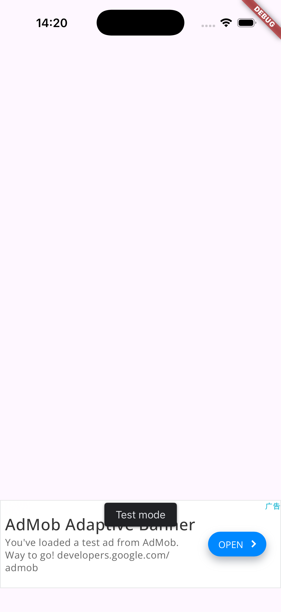
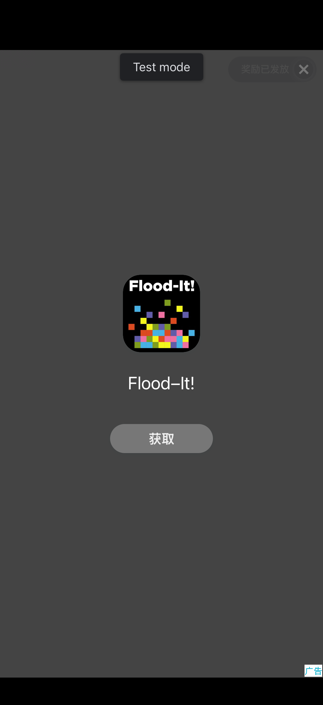

# AI Ad Monetization

[English](README.md) · [中文](README.zh-CN.md)

应用已经写好。现在让它赚钱。

写代码的 Agent 擅长做产品，做广告时却会乱来：选错平台，跳过隐私同意，把 Google 测试 ID 带进正式包，还把编译通过当成广告能播。把这个仓库交给你的 Agent。它会选定平台，把 AdMob 写进 Flutter，没真正跑过的检查绝不会标成通过。

[](LICENSE)
[](package.json)
[](knowledge/platforms/admob/sdk/flutter.json)

`docs/` 里的指南是中文。英文入口在 [README.md](README.md)。双语产品页在 [`site/`](site/index.html)。

## 里面有什么

三部分可以一起用，也可以拆开用。

| 部分 | 位置 | 作用 |
| --- | --- | --- |
| MCP 服务器 | `packages/mcp-server` | 14 个工具。12 个只读，1 个执行构建和测试命令，1 个写入工程，而且必须先确认计划。 |
| Skills | `skills/` | 8 个工作流。规定调用哪个工具、如何取舍、某一步失败后怎么办。 |
| 知识库 | `knowledge/` | AdMob、AppLovin MAX、Unity LevelPlay。每条记录来源、版本和核对日期。 |

## 已在设备上跑通

下面三张图来自一次验收，工程是新建的 Flutter 3.47 应用，用的是 Google 官方测试广告位。不是效果图。

| iOS 横幅 | iOS 激励视频，奖励已发放 | Android 横幅 |
| --- | --- | --- |
|  |  |  |

同一次运行里，`flutter analyze` 没有问题，Android debug APK 和 iOS 模拟器构建都成功。设备冷烟测试在 iOS 上 6 项全部通过；Android 在模拟器能够访问 Google 广告服务器后也是 6 项全部通过。从中国大陆网络出口访问时，Android 激励视频的素材下载失败，这一项被记为失败。版本、命令和完整记录见[验收报告](docs/mvp-acceptance-report.md)。

## 范围

| 组合 | 等级 | 服务器的行为 |
| --- | --- | --- |
| AdMob × Flutter，Android 与 iOS | 自动接入 | 横幅、插屏、激励。含 UMP 同意流程、SKAdNetwork，默认使用测试 ID。 |
| AdMob × 原生 Android、iOS 或 Unity | 委派 | 指向 Google 官方 Skill：`npx skills add google/skills/skills/ads` |
| Unity LevelPlay × Unity | 委派 | 指向 Unity 官方 Skill：`npx skills add Unity-Technologies/skills` |
| AppLovin MAX、LevelPlay × Flutter，以及其他 | 仅知识库 | 可以比较、可以查文档。不会写入工程。 |

## 快速开始

需要 Node.js 20 或更新版本。

```bash
npm install
npm run build
node packages/mcp-server/scripts/smoke-stdio.mjs
```

只给当前 Claude Code 会话加载插件，不改全局配置：

```bash
claude --plugin-dir /path/to/ai-ad-monetization
```

然后先要计划，再允许写入：

> 给这个 Flutter 应用加横幅、插屏和激励视频。写入之前先给我看计划。

`bash scripts/e2e-build.sh ios` 会把 `examples/flutter_demo_app` 复制到临时目录再跑完整链路，示例工程本身不会被改。Android 构建需要 JDK 17 和 Android SDK 36。缺任何一个，对应步骤会跳过，并在输出里说明。

Cursor 和其他 MCP 客户端的接法见 [docs/install.md](docs/install.md)。

## 一次写入怎么发生

1. `analyze_project` 读取应用：框架、原生配置、已经存在的广告代码。
2. `recommend_ad_platform` 给出平台和理由。面向美国和欧洲的 Flutter 新闻应用，结果是 AdMob。
3. `generate_ad_integration` 以 `mode: "plan"` 返回 diff 和计划哈希。此时不改文件。
4. 再次调用时带上 `mode: "apply"`、`confirm: true` 和 `expectedPlanHash` 才会写入。计划生成后工程又被改过，会返回 `PLAN_MISMATCH`，什么都不写。
5. `validate_ad_config` 做静态校验。`verify_ad_integration` 接着跑静态、构建，以及在传入设备 id 时加载真实测试广告的冷烟测试。

不经过 Agent，也可以用 CLI：

```bash
node packages/mcp-server/dist/cli.js plan  <project> --formats banner,interstitial,rewarded
node packages/mcp-server/dist/cli.js apply <project> --formats banner,interstitial,rewarded --yes
node packages/mcp-server/dist/cli.js verify <project> --levels static,build,runtime --devices <id> --show-fullscreen
```

`verify` 的退出码：请求的级别都没有失败是 0，静态、构建或运行时失败是 1，请求的级别全部被跳过是 3。

## 工具

| 工具 | 权限 | 作用 |
| --- | --- | --- |
| `search_ad_platforms` | 只读 | 按关键词、框架、市场检索平台。 |
| `compare_ad_platforms` | 只读 | 比较格式、聚合、框架支持和市场适配。 |
| `recommend_ad_platform` | 只读 | 按应用类别、目标和市场给出推荐。 |
| `get_platform_docs` | 只读 | 返回知识库里的官方摘要和链接。 |
| `get_sdk_compatibility` | 只读 | SDK 版本要求，可以对照具体工程。 |
| `analyze_project` | 只读 | 框架、原生配置、已有广告代码、隐私组件。 |
| `get_integration_guide` | 只读 | 接入步骤，或者应该安装的官方 Skill。 |
| `plan_ad_placements` | 只读 | 广告位、频控和布局风险。 |
| `validate_ad_config` | 只读 | 静态规则，分 `development` 和 `release` 两种口径。 |
| `build_integration_report` | 只读 | 生成 Markdown 接入报告。 |
| `get_ad_revenue` | 只读 | 从导出文件读取收益，或用你自己提供的令牌调用 AdMob API。 |
| `analyze_ad_performance` | 只读 | eCPM、填充率、展示率、点击率，以及启发式建议。 |
| `verify_ad_integration` | 执行命令 | 静态、构建、运行时。不改源码。 |
| `generate_ad_integration` | **写入** | 先计划，确认后再写。写入前备份，重复执行不会重复插入。 |

## Skills

| Skill | 负责 |
| --- | --- |
| `ad-monetization` | 整条流程的顺序。 |
| `ad-platform-selector` | 选择广告平台。 |
| `ad-unit-planner` | 广告放在哪里、多久出现一次。 |
| `ad-compliance-checker` | UMP、美国州隐私、ATT、儿童定向。 |
| `ad-sdk-integrator` | 把 SDK 写进工程。 |
| `ad-config-validator` | 静态规则。 |
| `ad-integration-tester` | 构建和设备上的冷烟测试。 |
| `ad-revenue-optimizer` | 读收益，并给出不违反 AdMob 政策的调整建议。 |

## 服务器实际遵守的规则

- 不重写官方 Skill。已有官方覆盖的组合返回 `delegate-official-skill` 和安装命令。
- Skill 只引用工具名，不引用服务器实现。没有 MCP 时，Skill 里仍有一套书面步骤。
- `PlatformAdapter` 只描述一个广告平台能做什么。各适配器自己校验自己的参数。
- 计划按工程的当前内容生成。计划要改的文件如果有未提交改动，默认拒绝写入，除非传入 `allowDirty`。
- 生成代码使用 Google 测试 ID。正式 ID 用 `--dart-define` 注入。`release` 口径下，测试 ID 还在就会失败。
- 新代码放在 `lib/ads/`。`main.dart` 的改动夹在 `ai-ad-monetization:begin/end` 标记之间。已有配置跳过。写入前把原文件复制到 `.ai-ad-monetization/backups/`。
- 初始化先走 UMP 同意流程。只有 `canRequestAds()` 为 true 时才调用 `MobileAds.instance.initialize()`。
- 静态、构建、运行时是三项独立结果。缺少 JDK 或 Android SDK 时，Android 构建记为跳过，报告里写明 Android 构建未验证。
- 创建 AdMob 应用、广告位、隐私消息和 API 令牌由你自己完成。工具只给出步骤。

## 目录

```
packages/mcp-server/   服务器、CLI、适配器、测试
skills/                8 个 Agent Skill
knowledge/             平台、SDK、隐私、错误码
examples/              未改动的 Flutter 示例工程，以及示例提示词
scripts/               插件启动、知识库检查、端到端脚本
docs/                  调研、架构、安装、使用、排错
site/                  双语产品页和使用说明页
```

## 文档

| | |
| --- | --- |
| [安装](docs/install.md) | 插件、单独的 MCP 配置、环境变量。 |
| [使用](docs/usage.md) | 工具调用、生成的 Dart API、CLI。 |
| [示例提示词](examples/prompts.md) | 可以直接贴给 Agent 的句子。 |
| [故障排查](docs/troubleshooting.md) | 错误码、构建失败、中国大陆网络下的激励视频。 |
| [架构](docs/architecture.md) | 设计契约。 |
| [竞品笔记](docs/research/competitive-analysis.md) | 官方 Skill，以及本仓库不重复实现的部分。 |
| [路线图](docs/roadmap.md) | 接入 MAX、LevelPlay 和聚合适配器的工作量。 |
| [验收报告](docs/mvp-acceptance-report.md) | 本 README 所引用的那次运行。 |

## 许可证

[MIT](LICENSE)
