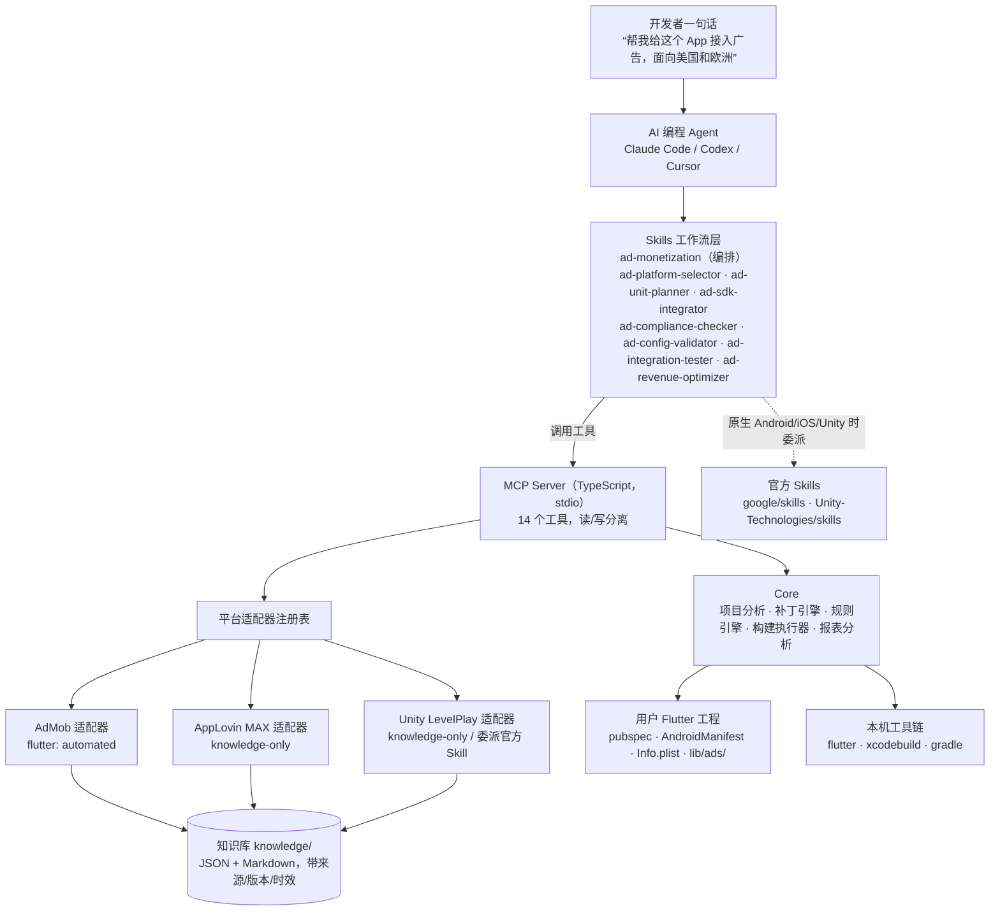
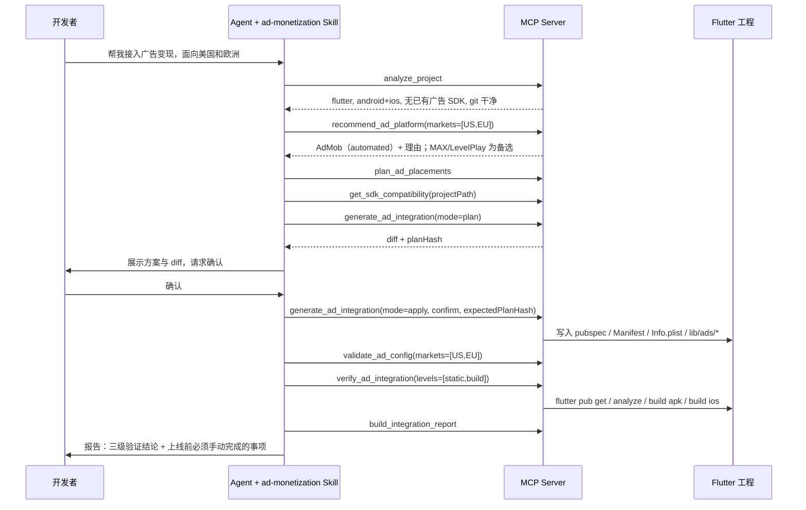

# 架构设计：AI Ad Monetization

> 版本 0.1（MVP：AdMob × Flutter × Android/iOS × Banner/Interstitial/Rewarded）。竞品结论见 `docs/research/competitive-analysis.md`。

## 1. 分层与职责



| 层 | 负责 | 不负责 |
| --- | --- | --- |
| Skills | 判断逻辑、提问与检查点、调用顺序、错误处理分支、何时委派官方 Skill | 不直接拼代码、不硬编码版本号与 ID |
| MCP Server | 确定性能力：探测、比较、生成补丁、检查、跑构建、算指标；读写注解与确认 | 不做"要不要接广告"之类的产品判断 |
| 平台适配器 | 把某个平台在某个框架下的知识与能力封装起来；各平台自带专属参数 | 不强行统一不同平台的 API |
| 知识库 | 官方事实与出处：版本、兼容性、ID、API、合规、错误码 | 不存未经验证的结论；主观评估必须标注 `editorial` |

## 2. 目录结构

```
AI-Ad-Monetization/
├── package.json                    npm workspaces 根；scripts: build / test / kb:check / e2e:build
├── .mcp.json                       插件内 MCP 声明（Claude Code）
├── .claude-plugin/plugin.json      Claude Code 插件清单
├── .codex-plugin/plugin.json       Codex 插件清单
├── .cursor-plugin/plugin.json      Cursor 插件清单
├── packages/mcp-server/
│   ├── package.json                @ai-ad-monetization/mcp-server，bin: ad-monetization-mcp / ad-monetization
│   ├── src/
│   │   ├── index.ts                stdio 入口
│   │   ├── cli.ts                  无 Agent 的命令行（analyze/plan/apply/validate/verify），供 CI 与 e2e
│   │   ├── server.ts               createServer()：注册工具与资源
│   │   ├── lib/                    envelope.ts · errors.ts · annotations.ts · fs.ts · hash.ts · exec.ts
│   │   ├── knowledge/              loader.ts · schema.ts（zod）· freshness.ts
│   │   ├── core/
│   │   │   ├── project/            analyze.ts · detectors/{flutter,android,ios,react-native,unity}.ts
│   │   │   ├── selection/          recommend.ts · compare.ts
│   │   │   ├── planning/           placements.ts
│   │   │   ├── patch/              types.ts · apply.ts · pubspec.ts · android-manifest.ts · gradle.ts · plist.ts · podfile.ts · dart-main.ts
│   │   │   ├── validation/         engine.ts（规则注册与评分）
│   │   │   ├── verify/             toolchain.ts · build-runner.ts
│   │   │   ├── revenue/            import.ts（CSV/JSON）· metrics.ts · insights.ts
│   │   │   └── report/             integration-report.ts
│   │   ├── adapters/
│   │   │   ├── types.ts            PlatformAdapter 接口
│   │   │   ├── registry.ts
│   │   │   ├── admob/              index.ts · flutter/{plan.ts, templates/*.ts, rules.ts} · revenue-api.ts
│   │   │   ├── applovin-max/index.ts
│   │   │   └── unity-levelplay/index.ts
│   │   └── tools/                  每个工具一个文件，导出 register(server, ctx)
│   └── test/                       vitest；fixtures/ 下是最小 Flutter 工程等
├── knowledge/
│   ├── index.json
│   ├── common/                     placement-rules.json · markets.json · benchmarks.json（启发式，标 editorial）
│   └── platforms/
│       ├── admob/                  platform.json · sdk/flutter.json · test-ids.json · privacy.json · skadnetwork.json · errors.json · docs/*.md
│       ├── applovin-max/           platform.json
│       └── unity-levelplay/        platform.json
├── skills/<skill-name>/SKILL.md + references/*.md
├── scripts/                        check-knowledge.mjs · e2e-build.sh
├── examples/                       使用示例（提示词与期望输出）
└── docs/                           research/ · architecture.md · install.md · usage.md · troubleshooting.md · roadmap.md · mvp-acceptance-report.md
```

## 3. 核心接口

### 3.1 统一返回信封

所有工具同时返回 `content`（人可读摘要）和 `structuredContent`（下述结构，并声明 `outputSchema`）。

```ts
interface SourceRef {
  title: string;
  url: string;
  retrievedAt: string;        // ISO 日期
  verifiedVersion?: string;   // 例如 "google_mobile_ads 9.2.0"
  stale: boolean;             // 超过 reviewIntervalDays 未复核
}

interface ToolResult<T> {
  ok: true;
  summary: string;
  data: T;
  warnings: string[];
  sources: SourceRef[];
  nextSteps: string[];
}

interface ToolError {
  ok: false;
  error: { code: ErrorCode; message: string; hint?: string; details?: unknown };
}

type ErrorCode =
  | 'INVALID_INPUT' | 'PROJECT_NOT_FOUND' | 'UNSUPPORTED_FRAMEWORK'
  | 'UNSUPPORTED_COMBINATION' | 'DIRTY_WORKTREE' | 'CONFIRMATION_REQUIRED'
  | 'PLAN_MISMATCH' | 'TOOLCHAIN_MISSING' | 'COMMAND_FAILED'
  | 'AUTH_REQUIRED' | 'KNOWLEDGE_MISSING' | 'INTERNAL';
```

错误以 `isError: true` 返回，`structuredContent` 为 `ToolError`。

### 3.2 平台适配器

不同平台的专属参数各自用 zod 定义，不强行统一（设计原则 4）。

```ts
type PlatformId = 'admob' | 'applovin-max' | 'unity-levelplay';
type Framework = 'flutter' | 'android' | 'ios' | 'react-native' | 'unity';
type AdFormat = 'banner' | 'interstitial' | 'rewarded' | 'rewarded_interstitial' | 'native' | 'app_open';
type SupportLevel = 'automated' | 'delegate-official-skill' | 'guided' | 'unsupported';

interface PlatformAdapter {
  readonly id: PlatformId;
  readonly displayName: string;
  supportFor(framework: Framework): { level: SupportLevel; officialSkill?: OfficialSkillRef; note?: string };
  formats(framework: Framework): AdFormat[];
  /** 平台专属参数（例如 AdMob 的 useNextGenSdk），由适配器自己校验 */
  readonly optionsSchema: z.ZodTypeAny;
  getIntegrationGuide(input: GuideInput): IntegrationGuide;
  planIntegration?(project: ProjectAnalysis, input: PlanInput): Promise<IntegrationPlan>;
  validationRules?(framework: Framework): ValidationRule[];
  fetchRevenue?(query: RevenueQuery): Promise<RevenueRows>;
}

interface OfficialSkillRef { name: string; repo: string; install: string; docsUrl: string }
```

MVP 中只有 `admob` 实现了 `planIntegration`（flutter）与 `validationRules`；`applovin-max`、`unity-levelplay` 只提供知识、对比和指南（Unity 引擎项目返回 `delegate-official-skill`）。

### 3.3 项目分析结果

```ts
interface ProjectAnalysis {
  root: string;
  framework: Framework | 'unknown';          // 取"最外层、拥有构建的工程"
  frameworkEvidence: string[];               // 例如 "pubspec.yaml 依赖 flutter sdk"
  targets: { android: boolean; ios: boolean; web: boolean; desktop: boolean };
  appName?: string;
  identifiers: { androidApplicationId?: string; iosBundleId?: string };
  flutter?: {
    dartSdkConstraint?: string;
    entryFile?: string;                      // lib/main.dart
    hasMainRunApp: boolean;
    dependencies: Record<string, string>;
  };
  android?: { manifestPath?: string; gradleFile?: string; minSdk?: number | 'flutter-default'; compileSdk?: number | 'flutter-default'; admobAppId?: string };
  ios?: { infoPlistPath?: string; podfilePath?: string; deploymentTarget?: string; admobAppId?: string; skAdNetworkCount: number; hasAttDescription: boolean };
  existingAdSdks: Array<{ platform: PlatformId | 'other'; name: string; version?: string; location: string }>;
  existingAdCode: Array<{ file: string; symbols: string[] }>;   // 已有 MobileAds/BannerAd 等调用
  screens: Array<{ file: string; widget: string; scrollable: boolean }>;  // 启发式，用于广告位规划
  git: { isRepo: boolean; dirtyFiles: string[] };
  toolchain: { flutter?: string; dart?: string; xcode?: string; java?: string; androidSdk?: boolean };
  issues: string[];
}
```

### 3.4 补丁与集成计划（写操作的核心）

```ts
interface FileChange {
  path: string;                    // 相对工程根
  action: 'create' | 'modify' | 'skip';
  reason: string;
  beforeHash?: string;             // modify/skip 时原文件 sha256
  diff?: string;                   // unified diff
  content?: string;                // create 时的完整内容（plan 输出时可截断）
}

interface IntegrationPlan {
  platform: PlatformId; framework: Framework; formats: AdFormat[];
  usesTestIds: true;               // MVP 恒为 true
  changes: FileChange[];
  manualSteps: string[];           // 例如 "在 AdMob 后台创建 GDPR 消息"
  planHash: string;                // sha256(稳定序列化的 changes)
}
```

写入规则：

1. `generate_ad_integration` 默认 `mode: "plan"`，只返回计划和 diff，不落盘。
2. `mode: "apply"` 必须同时传 `confirm: true` 与 `expectedPlanHash`；服务端重新计算计划，哈希不一致返回 `PLAN_MISMATCH`（防止用户确认的内容与实际写入不同）。
3. 计划涉及的文件在 git 中有未提交改动时返回 `DIRTY_WORKTREE`，除非 `allowDirty: true`。
4. 每次 apply 把被修改文件备份到 `.ai-ad-monetization/backups/<timestamp>/`，并写 `.ai-ad-monetization/integration.json`（记录版本、格式、变更文件、planHash）。
5. 补丁全部幂等：已存在的配置判定为 `skip`；对用户已有的真实 App ID 一律不覆盖；生成到用户文件里的片段用 `// ai-ad-monetization:begin` / `// ai-ad-monetization:end` 包裹。
6. 只新增 `lib/ads/` 下的文件；对 `lib/main.dart` 只在能识别 `runApp(` 时插入一行初始化调用和 import，识别不了就放进 `manualSteps`，不猜。

### 3.5 检查规则

```ts
type CheckStatus = 'pass' | 'warning' | 'fail' | 'na';
interface ValidationFinding {
  ruleId: string; title: string; status: CheckStatus;
  message: string; file?: string; line?: number; fix?: string; source?: SourceRef;
}
interface ValidationRule {
  id: string; title: string; category: 'config' | 'code' | 'compliance' | 'release';
  check(ctx: RuleContext): ValidationFinding | ValidationFinding[];
}
```

`validate_ad_config` 支持 `profile: "development" | "release"`：开发模式下测试 ID 为 `pass`（并提示）；发布模式下测试 ID 为 `fail`。

AdMob × Flutter 首批规则：`ADMOB_PLUGIN_PRESENT`、`ADMOB_PLUGIN_VERSION`、`DART_SDK_CONSTRAINT`、`ANDROID_APP_ID`（存在 + 正则）、`IOS_APP_ID`、`APP_ID_PLATFORM_MISMATCH`、`TEST_APP_ID`、`TEST_AD_UNIT`、`AD_UNIT_FORMAT`、`ANDROID_MIN_SDK`、`IOS_DEPLOYMENT_TARGET`、`IOS_SKADNETWORK`、`SDK_INITIALIZED`、`CONSENT_FLOW`、`CAN_REQUEST_ADS_GATE`、`PRIVACY_OPTIONS_ENTRY`、`BANNER_DISPOSE`、`FULLSCREEN_DISPOSE`、`DEPRECATED_BANNER_SIZE_API`、`CHILD_DIRECTED_TAG`（当用户声明面向儿童时）。

### 3.6 三级验证

| 级别 | 做什么 | 结论含义 |
| --- | --- | --- |
| `static` | 跑 `validate_ad_config` 的全部规则 | 配置与代码"看起来"正确 |
| `build` | `flutter pub get` → `flutter analyze` → `flutter build apk --debug` → `flutter build ios --simulator --debug --no-codesign`（仅 macOS） | 能编译、依赖可解析 |
| `runtime` | 生成人工核对清单：模拟器上出现 "Test Ad" 标签、日志中出现初始化完成、UMP 表单在 EEA 调试地理下弹出、激励回调触发 | 广告真实可请求、可展示 |

缺工具链时 `build` 级返回 `skipped` + `TOOLCHAIN_MISSING` 原因，**绝不报告通过**。`runtime` 级默认 `requires_manual_verification`。

## 4. MCP 工具清单

`R` = 只读（`readOnlyHint: true`）；`W` = 修改工程（`destructiveHint: true` + `_meta["anthropic/requiresUserInteraction"] = true`）；`X` = 执行本地命令但不改源码（`readOnlyHint: false, destructiveHint: false`）。

| 工具 | 类型 | 主要输入 | 主要输出 |
| --- | :-: | --- | --- |
| `search_ad_platforms` | R | `query?`、`framework?`、`format?`、`market?` | 平台列表 + 每个平台在该框架下的 `SupportLevel` |
| `compare_ad_platforms` | R | `platformIds[]`、`framework`、`markets[]` | 维度表：框架支持、格式、聚合、上手难度、市场适配、报表 API、官方 Skill |
| `recommend_ad_platform` | R | `framework`、`targets[]`、`markets[]`、`appCategory`、`goal: revenue\|ux\|balanced`、`formats?`、`needMediation?`、`existingSdks?` | 排序结果 `{platformId, score, reasons[], cautions[], supportLevel}` + 假设说明 |
| `get_platform_docs` | R | `platformId`、`topic`（init/banner/interstitial/rewarded/privacy/testing/errors…）、`framework?` | 知识库条目正文 + 来源 + 时效 |
| `get_sdk_compatibility` | R | `platformId`、`framework`、`projectPath?` | 插件版本、Flutter/Dart 下限、Android minSdk/compileSdk、iOS 部署目标、原生 SDK 版本；给了工程路径时附逐项对比 |
| `analyze_project` | R | `projectPath` | `ProjectAnalysis` |
| `plan_ad_placements` | R | `appCategory`、`goal`、`formats?`、`screens?`（可来自 analyze_project） | 广告位方案：格式、位置、触发时机、频控、Banner 类型（anchored/inline）、理由 |
| `get_integration_guide` | R | `platformId`、`framework`、`formats[]` | 有序步骤；原生/Unity 时返回 `delegate-official-skill` 与安装命令 |
| `validate_ad_config` | R | `projectPath`、`platformId`、`profile`、`markets?`、`childDirected?` | `ValidationFinding[]` + 汇总计数 |
| `generate_ad_integration` | W | `projectPath`、`platformId`、`formats[]`、`mode: plan\|apply`、`confirm?`、`expectedPlanHash?`、`allowDirty?`、`wireMain?`（默认 true）、`platformOptions?` | `IntegrationPlan`（apply 时附写入结果与备份路径） |
| `verify_ad_integration` | X | `projectPath`、`levels[]`、`targets[]`、`timeoutSec?` | 每级每步：命令、退出码、耗时、`passed/failed/skipped`、日志尾部 |
| `build_integration_report` | R | `projectPath`、可选传入上述工具结果 | Markdown 报告（由 Agent 决定是否写入文件） |
| `get_ad_revenue` | R | `platformId`、`source: file\|admob_api`、`filePath?`、`publisherId?`、`startDate`、`endDate`、`dimensions?` | 归一化收益行；`admob_api` 需要用户提供的 `ADMOB_ACCESS_TOKEN`，否则 `AUTH_REQUIRED` |
| `analyze_ad_performance` | R | `rows[]` 或 `filePath` | eCPM、填充率（match rate）、展示率（show rate）、CTR，按维度拆分，异常与建议（建议标注 `heuristic`） |

MCP 资源：`ad-monetization://capabilities`（平台 × 框架支持矩阵与"不支持"清单）、`ad-monetization://knowledge/{platformId}`。

## 5. Skills

均遵循 Agent Skills 标准：目录名 = `name`，frontmatter 含 `name`、`description`（写清触发场景），正文是工作流骨架，细节放 `references/`。每个 Skill 必须包含：前置条件、执行步骤、判断逻辑、错误处理表、参考文档。

| Skill | 触发 | 主要工具 | 关键判断 |
| --- | --- | --- | --- |
| `ad-monetization` | "帮我给 App 接广告变现" | 编排下列 Skill | 一次性收集市场/类型/目标；无交互时取默认值（balanced、三种格式）并在报告中说明 |
| `ad-platform-selector` | 选平台、比较平台 | analyze_project · recommend_ad_platform · compare_ad_platforms | 支持级别为 `delegate-official-skill` 时转官方 Skill；`unsupported` 时如实说明 |
| `ad-unit-planner` | 规划广告位 | plan_ad_placements · get_platform_docs | 可滚动→inline，不可滚动→large anchored；插屏只放自然断点；激励必须用户主动 |
| `ad-sdk-integrator` | 接入 SDK | get_sdk_compatibility · get_integration_guide · generate_ad_integration | 门禁：先 analyze；工具链/版本不满足先停；先 plan 给用户看 diff，再 apply |
| `ad-compliance-checker` | 隐私、GDPR、ATT、COPPA | validate_ad_config(markets) · get_platform_docs(privacy) | EEA/UK → UMP 必需；美国州隐私法 → UMP 美国州消息；面向儿童 → 子女导向标记；声明"非法律建议" |
| `ad-config-validator` | 检查配置、上线前审计 | validate_ad_config | development / release 两种口径 |
| `ad-integration-tester` | 测试、构建验证 | verify_ad_integration · build_integration_report | 三级结论分开写；工具链缺失时报告"未验证" |
| `ad-revenue-optimizer` | 收益、eCPM、填充率 | get_ad_revenue · analyze_ad_performance | 账号授权由用户完成；建议标注为启发式；推荐并装社区 AdMob MCP 获取在线数据 |

## 6. 知识库

- 格式：JSON（由 zod schema 校验，测试中全量校验）+ Markdown 摘录（frontmatter 含 `source`、`retrievedAt`、`verifiedVersion`）。
- 每个文件有 `reviewIntervalDays`（默认 120）；加载器按 `retrievedAt` 计算 `stale`，所有工具把它放进 `sources[].stale` 与 `warnings`。
- 主观评估（例如平台在某市场的"强弱"打分）必须放在 `editorial` 字段并在输出中标注，不能和官方事实混在一起。
- `npm run kb:check`：查询 pub.dev API 中 `google_mobile_ads` 最新版本，与知识库对比，只报告漂移，不自动改写（更新知识必须人工复核官方文档后提交）。

## 7. 端到端工作流（MVP）



## 8. 生成的 Flutter 代码（`lib/ads/`）

| 文件 | 内容 |
| --- | --- |
| `ad_unit_ids.dart` | 按平台返回广告单元 ID；默认 Google 测试 ID，可用 `--dart-define=ADMOB_ANDROID_BANNER_ID=...` 覆盖；暴露 `usingTestIds` |
| `ads_consent.dart` | UMP：`requestConsentInfoUpdate` → `loadAndShowConsentFormIfRequired`；`canRequestAds`、`isPrivacyOptionsRequired`、`showPrivacyOptionsForm` |
| `ads_initializer.dart` | 单例；先同意流程，`canRequestAds()` 为真时再 `MobileAds.instance.initialize()`，只初始化一次，暴露 `ready` |
| `anchored_banner_ad.dart` | `AnchoredBannerAd` 组件：`getLargeAnchoredAdaptiveBannerAdSize`，`SizedBox` 包裹 `AdWidget`，失败和卸载时 `dispose` |
| `interstitial_ad_controller.dart` | 预加载、`showIfReady()`、最小展示间隔（默认 180 秒）、关闭后重新加载、回调中 `dispose` |
| `rewarded_ad_controller.dart` | 预加载、`isReady`、`show(onReward)`、关闭后重新加载、回调中 `dispose` |
| `ads.dart` | 统一导出 |

只生成用户选择的格式；`ads_consent.dart` 和 `ads_initializer.dart` 总是生成。

## 9. 安全与原则落地

| 原则 | 落地方式 |
| --- | --- |
| 不重复造官方能力 | 知识库 `officialSkill` 字段 + `delegate-official-skill` 支持级别 |
| MCP 与 Skills 解耦 | Skill 只依赖工具名和信封结构；替换平台只需新增适配器与知识 |
| 统一接口但不强行抽象 | 公共字段走 `PlatformAdapter`，平台专属参数走各自 `optionsSchema` |
| 改动前检查 | `generate_ad_integration` 内部先跑 `analyze_project`；已有 SDK/ID → skip |
| 默认测试 ID | 生成代码默认测试 ID；`usesTestIds: true`；发布口径检查会拦截 |
| 不覆盖业务逻辑 | 只新增 `lib/ads/`；对 `main.dart` 仅插入带标记的一行；不改用户页面布局 |
| 合规纳入流程 | 初始化总是经过 UMP；`ad-compliance-checker` 是编排中的必经步骤 |
| 区分三级验证 | `verify_ad_integration` 分级返回；报告分节 |
| 授权由用户完成 | 只读取用户提供的 token；不做 OAuth 代登录、不做浏览器自动化 |
