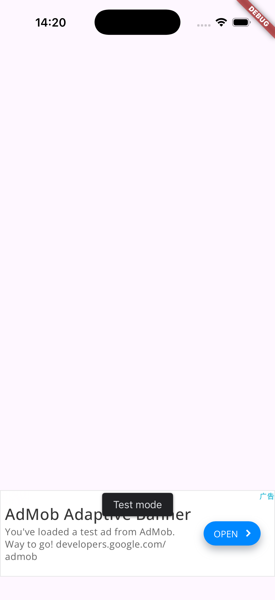
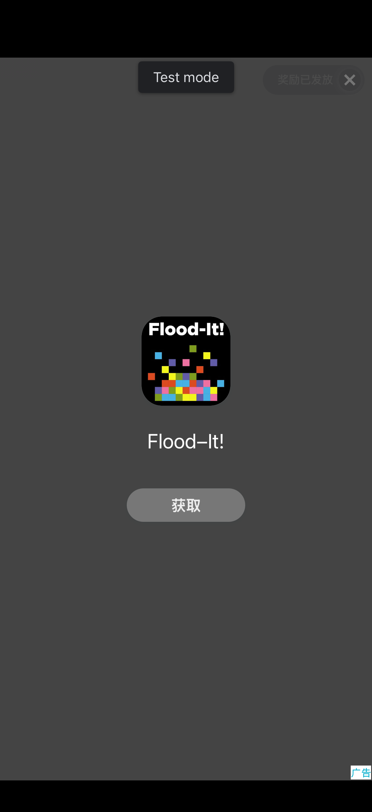
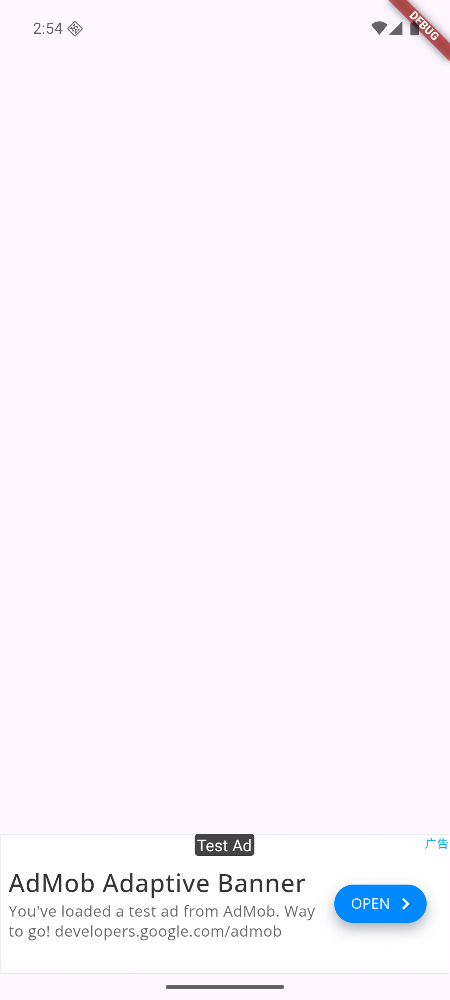

# MVP 验收报告

- 日期：2026-11-02（第二轮验收，覆盖 Android 构建与双平台运行时）
- 范围：AdMob × Flutter（Android + iOS），Banner / Interstitial / Rewarded
- 结论：**达到小规模公开试用标准。** 双平台构建通过；iOS 运行时全部通过；Android 运行时 6 项中 4 项通过，激励视频因测试网络环境无法加载素材，接入代码本身不是原因（见第 5 节）。

## 1. 验收环境

| 项 | 版本 |
| --- | --- |
| macOS | 26.5.2（Apple Silicon） |
| Node.js | 24.17.0 |
| Flutter | 3.47.9 stable |
| Xcode / CocoaPods | 26.6 / 1.17.0 |
| JDK | OpenJDK 17（Homebrew，经 `flutter config --jdk-dir` 配置） |
| Android SDK | platform 36、build-tools 36.0.0、cmdline-tools latest |
| iOS 模拟器 | iPhone 17，iOS 26.5 |
| Android 模拟器 | Pixel 7 配置，Android 16（API 36），Google APIs arm64 镜像 |
| Claude Code | 2.1.304 |
| google_mobile_ads | 9.2.0（知识库核实日期 2026-11-02） |
| 测试网络 | 中国大陆出口 |

被测工程：`examples/flutter_demo_app`，由 `flutter create --platforms android,ios` 生成且未修改。e2e 脚本复制到 `.tmp/e2e` 后操作，原工程保持不变。

## 2. 结果总览

| 验收项 | 结果 |
| --- | --- |
| TypeScript 类型检查、构建 | 通过 |
| 自动化测试 | 通过，15 个文件 150 个用例 |
| MCP stdio 冒烟 | 通过，14 个工具 |
| Claude Code 插件校验（`claude plugin validate .`） | 通过，无警告 |
| Agent 实际驱动（Claude Code 加载插件，自然语言请求） | 通过：识别 8 个 Skill、14 个工具；依次调用 `analyze_project` → `recommend_ad_platform` → `validate_ad_config`，全部成功，未修改文件 |
| 端到端接入 | 通过，写入 12 个文件（含冷烟测试） |
| 静态校验（development，US + EEA） | 通过：pass 21 / warning 0 / fail 0 / 不适用 1 |
| 静态校验（release） | 按预期失败 3 项（测试 App ID × 2、测试广告单元 ID × 1） |
| `flutter analyze` | 通过，`No issues found!` |
| **Android debug 构建** | **通过**（`flutter build apk --debug`） |
| iOS 模拟器构建 | 通过 |
| **iOS 运行时冷烟测试** | **6 / 6 通过** |
| **Android 运行时冷烟测试** | **4 / 6 通过**；激励视频加载失败（网络环境），奖励回调因此未测 |
| “Test Ad” 标签目视核对 | 双平台横幅截图确认（见第 4 节） |
| 生成内容语言 | 写入用户工程的代码和注释全部为英文 |

以上结果均由架构评审方在执行者自测之后独立重跑确认。

## 3. 运行时冷烟测试

接入时会在用户工程生成 `integration_test/ads_smoke_test.dart`，使用 Google 官方测试广告单元请求真实测试广告。`verify_ad_integration` 指定 `devices` 后会在这些设备上运行它并解析结果：

```
runtime: failed
  passed  922ED5F4-… [ios] 39.0s
    ✔ consent_eea 791ms — status=required formAvailable=true
    ✔ sdk_initialized 1199ms — AdsInitializer.initialize returned true
    ✔ banner_loaded 1947ms — AdWidget rendered
    ✔ interstitial_loaded 780ms — interstitial ad ready
    ✔ rewarded_loaded 3372ms — rewarded ad ready
    ✔ rewarded_reward_callback 9400ms — onReward fired (reward: 10.0 coins)
  failed  emulator-5554 [android-arm64] 114.4s — 未通过的检查: rewarded_loaded, rewarded_reward_callback
    ✔ consent_eea 1921ms — status=required formAvailable=true
    ✔ sdk_initialized 1278ms — AdsInitializer.initialize returned true
    ✔ banner_loaded 3537ms — AdWidget rendered
    ✔ interstitial_loaded 1806ms — interstitial ad ready
    ✘ rewarded_loaded 45158ms — load error: code=0 domain=com.google.android.gms.ads message=Internal error.
    ✘ rewarded_reward_callback 45457ms — rewarded ad not ready within 45s
    ? 诊断 rewarded_loaded[code=0]：可能是网络环境导致视频素材无法加载 … → 换网络重试（日志: adb logcat -s Ads）
```

各项含义：

- `consent_eea`：强制调试地区为欧洲经济区时，UMP 判定需要征求同意，且同意表单可用。
- `sdk_initialized`：先走同意流程，再初始化 SDK，返回成功。
- `*_loaded`：横幅渲染出 AdWidget，插屏和激励进入可展示状态。
- `rewarded_reward_callback`：实际展示激励广告并等到奖励回调。

## 4. 截图

| iOS 横幅 | iOS 激励视频（奖励已发放） | Android 横幅 |
| --- | --- | --- |
|  |  |  |

## 5. Android 激励视频失败的原因

`adb logcat -s Ads` 显示，激励视频的素材被分配到 `asset.gvt1-cn.com`（Google 面向中国大陆的 CDN）。该 CDN 的响应缺少 `Access-Control-Allow-Origin` 头，Android 广告 WebView 拦截了请求，SDK 随后报 `Ad failed to load : 0`。

判断这是网络环境问题而不是接入问题，依据有三点：

1. 同一份代码在 iOS 上加载激励视频并触发了奖励回调（iOS SDK 用原生播放器，不走 WebView 的跨域请求）。
2. Android 上同一初始化流程下的横幅和插屏都能加载。
3. 失败发生在素材下载阶段，请求本身已成功返回广告。

验证工具如实把该设备判为 `failed`，没有当作跳过。它从新增的 `lastLoadError` 中读出错误码，并给出网络环境诊断。在非中国大陆网络下复测这一项，是正式发布前的待办。

## 6. 本轮评审发现并已修复的问题

| 问题 | 影响 | 修复 |
| --- | --- | --- |
| 工具链探测只认 PATH 上的 `java` | macOS 的 `/usr/bin/java` 是占位程序，通过 `flutter config --jdk-dir` 配置的 JDK 会被误报为缺失 | 依次检查 `JAVA_HOME`、`flutter config` 和 `java -version`；Android SDK 目录必须实际含有组件 |
| “设备不存在”的判断匹配到普通 `not found` 文本 | 真实的广告加载失败会被误判为“设备未连接 → 跳过”，问题被掩盖 | 只在完全没有检查结果、且命中 Flutter 的设备错误文案时才判为跳过 |
| 广告加载失败时不留任何错误信息 | 开发者只能看到“广告一直不出来” | 控制器打印错误码、domain 和 message，并提供 `lastLoadError`；横幅新增 `onAdFailedToLoad` 回调 |
| 全屏广告展示期间调用 `tester.pump` 会卡死 | 冷烟测试挂起 | 全屏期间只按时间轮询 |

第一轮修复的问题（初始化失败结果被永久缓存、dispose 后的广告泄漏、类名子串误报、`flutter analyze` 只统计日志尾部等）见 git 历史。

## 7. 仍需人工确认的项

1. 在非中国大陆网络下重跑 Android 冷烟测试，确认激励视频与奖励回调。
2. 同意表单的界面交互，以及设置页的隐私选项入口（自动化只确认表单可用，没有点击）。
3. 插屏频控在真实使用中的表现。
4. 飞行模式下应用不崩溃、广告静默失败。
5. 替换为真实 ID 后，在真机注册测试设备再验证。真实广告的填充和收益无法由工具验证。

## 8. 已知限制

- 只在 `flutter create` 生成的工程上做过端到端验证，尚未用真实开源应用做回归（flavor、Groovy 写法的 Gradle、自定义 Podfile、非常规 `main()`）。
- AdMob Reporting API 只用模拟响应测试过。
- AppLovin MAX 与 Unity LevelPlay 只有知识库，不能自动接入。
- 仓库根目录的 `.mcp.json` 供插件使用，其中引用了 `${CLAUDE_PLUGIN_ROOT}`。直接把本仓库当作项目在 Claude Code 中打开时，会多出一个连接失败的项目级 MCP 服务器，不影响插件方式使用。

## 9. 复现步骤

```bash
npm install
npm run typecheck && npm test && npm run build
claude plugin validate .
bash scripts/e2e-build.sh all
# 运行时冷烟测试：先启动模拟器，再传入设备 id（flutter devices 查看）
E2E_DEVICES=<ios-simulator-id>,emulator-5554 E2E_SHOW_FULLSCREEN=1 bash scripts/e2e-build.sh all
```
